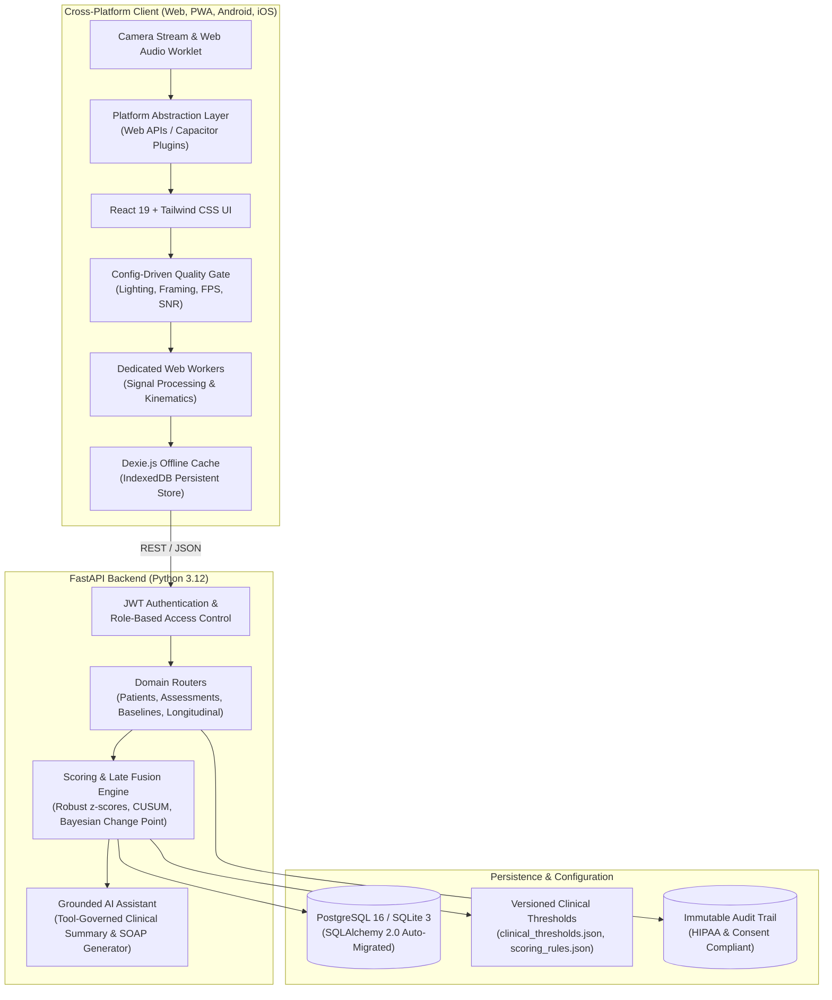

# NeuroCare System Architecture

NeuroCare is a contactless multimodal system for personalized neurological behavioral monitoring (Medaithon Track MED-PS-002). The platform empowers clinicians and patients to quantify subtle changes in motor, vocal, facial, gait, balance, and cognitive function without requiring wearable sensors or invasive hardware.

---

## 1. High-Level Architecture Overview

---

## 2. Multi-Platform Delivery & Native Bridges

NeuroCare is architected around a **Unified Platform Abstraction Layer (PAL)** located in `web/src/platform/`. The platform runs identically across four deployment form factors:

| Form Factor | Runtime Environment | Audio/Camera Driver | Storage Driver | Background Tasks |
|:---|:---|:---|:---|:---|
| **Web Browser** | Modern Desktop (Chrome, Edge, Firefox, Safari) | `navigator.mediaDevices.getUserMedia` | `localStorage` + IndexedDB | Web Workers |
| **Installable PWA** | Standalone PWA on Desktop & Mobile | Native browser media APIs | Dexie.js + Cache Storage | Workbox Service Worker |
| **Android App** | Native Android 14+ via Capacitor 8 (`app-debug.apk`) | Android Camera2 API via `@capacitor/camera` | Capacitor Preferences + SQLite | Foreground Service / Local Notifications |
| **iOS App** | iOS 17+ Xcode Workspace via `@capacitor/ios` | AVFoundation via `@capacitor/camera` | Capacitor Preferences + IndexedDB | Local Notifications |

### Platform Abstraction Interfaces (`web/src/platform/interfaces.ts`)
- **`CameraService`**: Controls live video preview, frame acquisition, facing mode selection, and safe hardware stream cleanup.
- **`MicrophoneService`**: High-frequency audio stream capture with real-time Signal-to-Noise Ratio (SNR) evaluation and voice activity detection (VAD).
- **`PermissionsService`**: Unified cross-platform camera and microphone permission validation.
- **`NetworkService`**: Continuous connectivity monitoring with automatic offline fallback state switches.
- **`StorageService`**: Secure offline key-value and structured record storage.

---

## 3. Real-Time Signal Processing & Quality Gating

Neurological motor and facial kinematics require low-latency frame processing without blocking the UI thread.

### Processing Pipeline
1. **Frame Ingestion**: Video streams are captured at 720p/1080p.
2. **Quality Gate (`web/src/modules/quality/qualityGate.ts`)**:
   - **Luminance Analysis**: Evaluates average frame brightness (rejects underlit < 40 or blown out > 220).
   - **Framing & Centering**: Validates region of interest (ROI) bounding box.
   - **Confidence Tracking**: Requires landmark detection confidence $\ge 0.60$.
   - **Throughput & Frame Rate**: Targets $\ge 15$ FPS. If the host device drops below 10 FPS, the system flags `limited` or `insufficient` quality, warning the user and prompting a retake.
   - **Audio Quality Gate**: Computes noise floor, peak clipping, voiced duration, and minimum SNR ($\ge 12\text{ dB}$).
3. **Web Worker Offloading (`web/src/workers/tappingWorker.ts`)**:
   - Computes Euclidean distance time series between index finger tip and thumb tip.
   - Peak-valley detection with dynamic thresholding to isolate individual tap cycles.
   - Computes instantaneous frequency, amplitude decay (decrement), and inter-tap interval irregularity.

---

## 4. Clinical Scoring & Late Fusion Engine

### Mathematical Formulations

#### 1. Robust Baseline Deviation ($z$-Score)
To prevent extreme baseline distortion from outliers, NeuroCare utilizes the median and Median Absolute Deviation (MAD):

$$\text{MAD} = \text{median}(|x_i - \tilde{x}|)$$

$$z = \frac{x_{\text{current}} - \tilde{x}}{\max(\text{MAD} \times 1.4826,\, \sigma_{\min})}$$

Where $\sigma_{\min} = 0.01$ serves as a clinical safety floor against division by zero in zero-variance sessions.

#### 2. Domain-Weighted Late Fusion
Domain subscores (Motor, Speech, Facial, Gait, Balance, Cognition) are aggregated into a composite monitoring index:

$$S_{\text{composite}} = \sum_{d \in D} w_d \cdot S_d$$

Where weights $w_d$ are defined in `config/scoring_rules.json` and dynamically re-normalized if a patient is medically unable to perform a specific assessment (e.g., balance skipped due to safety fall risk).

#### 3. Change-Point Detection (CUSUM)
To distinguish temporary fluctuations from genuine shifts in neurological status, NeuroCare runs cumulative sum tracking:

$$C_t^+ = \max(0, C_{t-1}^+ + z_t - k)$$
$$C_t^- = \min(0, C_{t-1}^- + z_t + k)$$

When $C_t^+ > h$ or $C_t^- < -h$ across 3 consecutive valid sessions, the system flags a **Persistent Monitoring Deviation** and notifies the overseeing clinician.

---

## 5. Grounded AI Assistant & Clinical Safety Guardrails

The conversational assistant (`api/app/services/grounded_ai_assistant.py`) operates under strict assistive constraints:
1. **Tool-Governed Grounding**: Answers are derived exclusively from 6 authorized backend functions:
   - `get_patient_baseline`
   - `get_recent_assessments`
   - `get_modality_trends`
   - `get_monitoring_deviations`
   - `get_assessment_quality`
   - `generate_clinician_summary`
2. **Deterministic Guardrails**: The system rejects speculative diagnostic questions ("Do I have Parkinson's disease?") with standard clinical guidance.
3. **Emergency FAST Protocol**: Any severe acute facial asymmetry or unilateral motor failure triggers an immediate Emergency Banner with direct 911/emergency dial links.
4. **Role Isolation**: Patients can never view other patients' data; clinician summaries require explicit doctor sign-off before becoming part of the permanent medical record.
