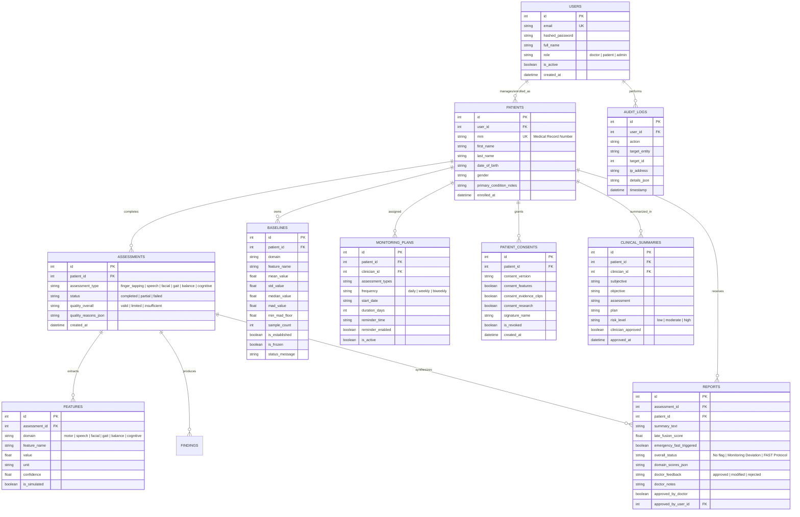

# NeuroCare Database Architecture & Data Models

NeuroCare utilizes a robust relational schema managed through SQLAlchemy 2.0 ORM. The platform supports local development and offline environments via **SQLite 3**, while containerized and cloud production environments utilize **PostgreSQL 16**.

---

## 1. Entity-Relationship Diagram

---

## 2. Table Specifications & Models

### `users` (`api/app/models/user.py`)
Stores credentials, role, and profile details. Role-based access control enforces strict isolation:
- `doctor`: Access to all assigned patients, clinical reports, SOAP summary generation, and monitoring plan assignment.
- `patient`: Access restricted exclusively to personal assessments, check-ins, reports, and AI assistant dialogues.

### `patients` (`api/app/models/patient.py`)
Clinical demographic profile, anonymized unique Medical Record Number (MRN), and clinician notes.

### `assessments` (`api/app/models/assessment.py`)
Represents an individual testing session. Carries config-driven quality gates (`valid`, `limited`, `insufficient`) along with human-readable diagnostic reasons.

### `features` (`api/app/models/feature.py`)
Granular kinematic, acoustic, or cognitive extracted metrics (e.g., `finger_tap_frequency_hz`, `vocal_jitter_percent`, `cadence_steps_per_min`, `trail_b_duration_sec`).

### `baselines` (`api/app/models/baseline.py`)
Stores the patient's individual behavioral baseline computed across at least 3 valid sessions using the median and Median Absolute Deviation (MAD).

### `patient_consents` (`api/app/models/consent.py`)
Explicit consent tracking for HIPAA / GDPR compliance:
- Granular permissions for extracted feature storage vs. video clip retention.
- Full revocation capability, which automatically purges all stored media from the system.

### `clinical_summaries` (`api/app/models/clinical_summary.py`)
Structured SOAP notes generated by the Grounded AI Assistant and approved by the clinician with cryptographic audit tracing.

### `audit_logs` (`api/app/models/audit_log.py`)
Immutable record of all patient data views, downloads, consent changes, and report sign-offs.

---

## 3. Database Migration & Compatibility

The system includes a zero-dependency **auto-migration engine** (`auto_migrate_sqlite` in `api/app/main.py`) that checks table definitions on startup and applies additive schema changes dynamically. This ensures existing SQLite development databases and production PostgreSQL databases upgrade seamlessly without data loss.
